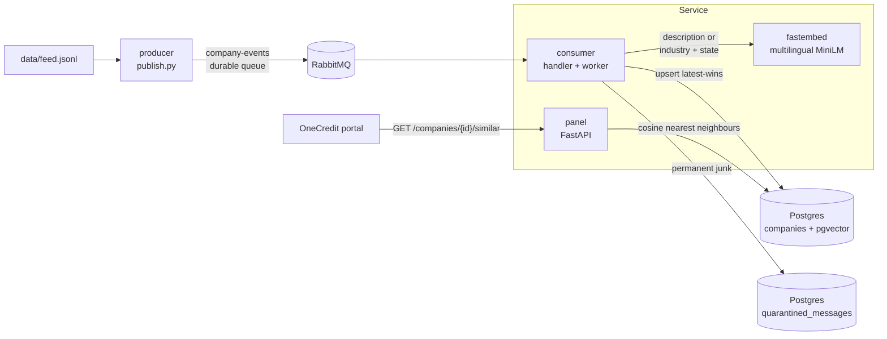

# Design

## What it does

The service turns the registry feed into a "similar companies" panel. A
producer replays `data/feed.jsonl` onto the durable `company-events` queue; the
consumer stores each company in Postgres with a pgvector embedding; the FastAPI
panel returns the nearest active companies for a registration number.



The consumer acknowledges stored messages, requeues transient failures, and
quarantines permanent junk; an unparseable `updatedAt` escapes the handler so
the worker stops loudly.

## Decisions

### The latest source state wins

Every event carries the time the change happened at the source in `updatedAt`.
The catalogue stores that as `source_updated_at` and lets a newer value replace
an older one, regardless of arrival order. Arrival order is not a tie-breaker:
RabbitMQ is at-least-once and redelivers, so the source time is the only stable
ordering.

`created_at` records when the row first arrived; `updated_at` moves on each
successful write. Neither is used to decide which message is newer.

Equal `source_updated_at` values need a deterministic rule, otherwise the row
depends on which duplicate arrives last. The rule is:

1. A strike-off beats an active row at the same source time, so a dead company
   is not left visible because an upsert arrived afterwards.
2. Otherwise the greater SHA-256 of the raw message wins. This is idempotent:
   redelivering the same message changes nothing, and two different messages
   converge to the same row in either arrival order.

The hash is over the raw body. The producer already uses the same value as the
AMQP `message_id`, so the message identity is consistent end to end.

### Embeddings

The model is
`sentence-transformers/paraphrase-multilingual-MiniLM-L12-v2`: 384 dimensions,
CPU-only, through `fastembed`. The embedding column is fixed at `vector(384)`.

The text to embed is chosen in `company_recommender/intake/parser.py`:

- `natureOfBusiness` when it is a non-empty string;
- otherwise `"{industry} in {state}"`, for example `"Retail in Kedah"`;
- state is title-cased for the embedding only;
- if neither industry nor state is known, the company has no embedding.

The description is the primary signal. `industry + state` alone would be much
coarser: the feed has 11 industries and about 16 real states, and 41 companies
share `Manufacturing + Selangor` while doing different things (rubber gloves,
plastic packaging, furniture, precision machining). Using only the bucket would
make all 41 identical to the vector search. The fallback exists because a
description-less company is otherwise never recommended.

The feed's descriptions are mixed English and Malay (at least 30% of them are
Malay by a simple function-word check). The first MVP used
`BAAI/bge-small-en-v1.5`, but the English-only model put a Malay description
closer to an unrelated English text than to its own English translation. The
multilingual model fixes that without changing the schema, and
`tests/test_embedder.py` checks the translation pair.

### Recommendations

`Catalogue.similar` runs a pgvector cosine-distance query (`<=>`):

- exclude the company itself;
- only `status = 'active'` rows;
- only rows with a non-null embedding;
- require the query company to have an embedding;
- return at most 4 cards.

Struck-off companies are stored but never recommended. A company with no
embedding still exists and can be looked up, but has no panel. An unknown
registration number returns an empty list rather than a 404.

There is no HNSW index yet. At ~2,000 rows the sequential scan is fast enough;
the 10x plan adds the index.

### Permanent junk versus transient failure

`Consumer.handle` separates three outcomes:

- `Rejection` (invalid JSON, null body, missing registration number or
  `updatedAt`, non-object `data`): write the raw body and reason to
  `quarantined_messages`, then acknowledge. Replaying it will never help.
- `Retry` (the catalogue or embedder raised): do not acknowledge, do not
  quarantine. The queue redelivers it.
- `Ack`: the row is stored (or the junk is quarantined).

An unparseable `updatedAt` is not junk. `datetime.fromisoformat` raises, the
exception escapes `interpret`, and the consumer stops with a traceback. That is
intentional: a bad timestamp is a data problem that should be seen rather than
silently quarantined. A feed-wide test asserts that every present `updatedAt`
in `data/feed.jsonl` parses, so a new bad value fails the suite before it
reaches the queue.

The quarantine table is append-only and records `created_at`. A redelivered
junk message would be inserted again; a unique constraint on `(raw, reason)`
would deduplicate it (see "What's left").

### Delivery and idempotency

The queue is durable with no extra arguments, matching the registry team's
declaration. The consumer uses `prefetch_count=1`, so one message is in flight
at a time and an embedding is not computed twice for the same delivery.

The primary key on `registration_number` plus the source-time and hash rules
makes upserts idempotent. The panel is read-only and needs no transaction with
the consumer.

### API

`GET /companies/{registration_number}/similar` returns:

```json
{"companies": [{"registrationNumber": "...", "companyName": "...", "industry": "...", "state": "..."}]}
```

Four cards, nearest first, self excluded, active only.

## Assumptions

- `updatedAt` without an offset is Malaysia time (`+08:00`); epoch
  milliseconds are UTC.
- The registration number is a stable company identity.
- The registry queue is the source of truth for event order; the service does
  not call back to the registry.
- State strings are display labels. The fallback normalises case only; full
  aliasing (`Pulau Pinang`/`Penang`) is not done.
- A missing or empty description is a normal case, not an error: 58 records in
  the feed have no description.
- Malformed individual fields can still raise. Missing `industry` or `state`
  is tolerated; a missing `companyName` is not.

## 10x the volume

- Batch the embeddings. `fastembed` accepts a list; the current loop embeds one
  text per message because it processes one message at a time.
- Add an HNSW index on `companies.embedding` and tune `hnsw.ef_search`. Measure
  recall and p95 latency before and after.
- Pool Postgres connections (`psycopg_pool`) and use more than one connection
  for writes and reads.
- Run several consumer processes against the same queue with a modest prefetch,
  and batch upserts where the source time allows it.
- Cache the top-4 cards per registration number, invalidated when that company
  is written (or with a short TTL).
- Move the panel reads to a replica; keep writes on the primary.
- Watch queue depth, consumer lag, Retry rate, quarantine rate, embedding
  latency, and panel p95.
- Add a dead-letter path for messages that keep failing, with an operator
  review step. The current `Retry` loop is intentionally simple.

## What's left

- A broader Malay/English evaluation (the current test checks one translation
  pair) and, if needed, a domain-tuned model.
- Full state normalisation and aliases.
- A deterministic tie-break for identical vectors (for example, registration
  number) so equal-distance cards have a stable order.
- Quarantine deduplication.
- HNSW index and a latency benchmark at a realistic scale.
- Graceful shutdown, health/readiness endpoints, structured logs, metrics, and
  auth/rate limiting on the panel.
- Schema migrations. `CREATE TABLE IF NOT EXISTS` is fine for a fresh local
  database but is not a migration strategy.
- A dead-letter/cap policy for a message that crashes the consumer repeatedly.

## AI tools

This solution was built with an AI coding agent (OpenCode) for implementation,
tests, and documentation. Each decision was reviewed and the full suite is run
locally before a ticket is merged.
